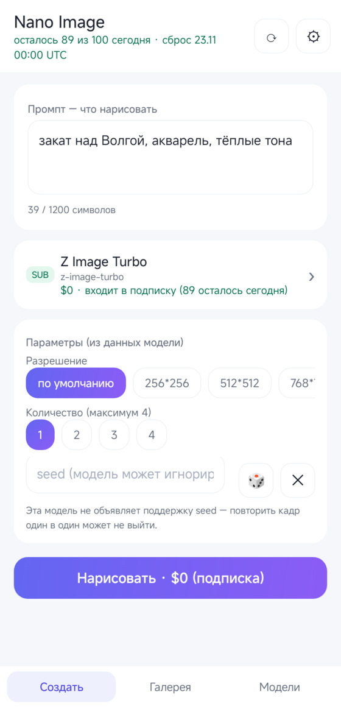
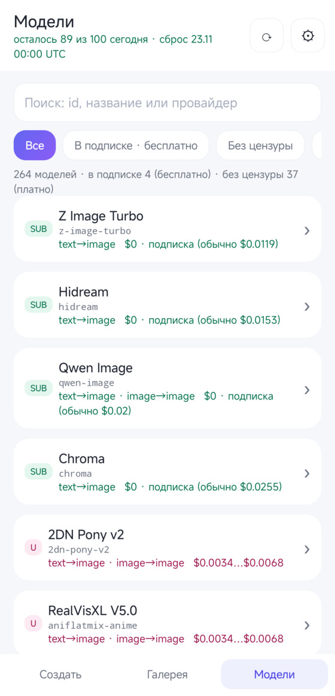
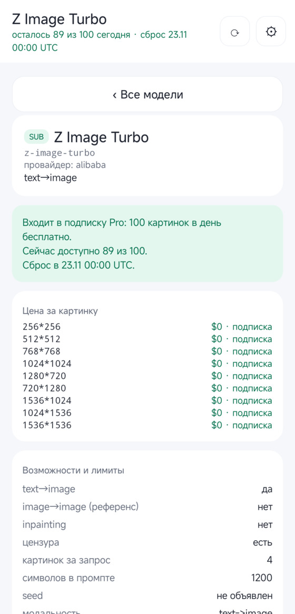
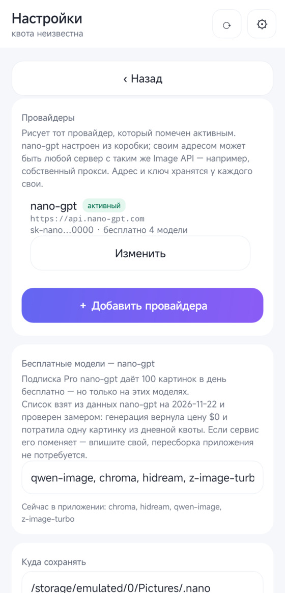

<div align="center">

# 🎨 Nano Image

**Генерация картинок по промпту прямо с телефона — с ценами, подпиской и цензурой как на ладони**

[🌐 Лендинг проекта](https://gotical.github.io/nano-image/)

[](https://github.com/gotical/nano-image/releases/latest/download/nano-image.apk)
[](#-сборка-из-исходников-termux-без-gradle)
[](LICENSE)

</div>

Nano Image — Android-клиент Image API [nano-gpt.com](https://nano-gpt.com) и любого
совместимого провайдера. Приложение затевалось ради одного вопроса: **«какие модели
рисуют бесплатно по подписке, а какие спишут деньги, и сколько именно?»** — и отвечает
на него до нажатия кнопки, а не после.

| | |
|---|---|
|  |  |
|  |  |

## ✨ Возможности

- 🧾 **Цена видна заранее.** На кнопке генерации, в списке моделей и в карточке модели —
  почём картинка, а после запроса показывается *фактическая* цена из
  `GET /api/v1/usage/requests/{id}` (подписка вернула `$0` или деньги списались).
- 🎁 **Подписка nano-gpt:** 100 картинок в день бесплатно на 4 моделях — приложение знает
  их список, показывает остаток квоты в шапке и время сброса.
- 🔞 **Цензура помечена.** Бейдж `U` — модель без цензуры (в подписку не входит никогда),
  `C` — с цензурой, `SUB` — покрыта подпиской и квота ещё есть.
- 💬 **Честное подтверждение.** Всё, что спишет деньги с баланса, спрашивает подтверждение
  диалогом с суммой; бесплатная генерация по подписке идёт без лишних вопросов.
- 🔌 **Несколько провайдеров.** Адрес и ключ задаются в настройках; провайдеров можно
  держать сколько угодно и переключаться между ними. Каталог, цены, подписочные модели
  и кэш у каждого свои.
- 🖼 **Image-to-image.** Модели с поддержкой референса принимают до N ваших фото
  (лимит берётся из данных модели, а не выдумывается).
- 📚 **Каталог целиком.** Все 264 модели nano-gpt с прайсом по разрешениям, лимитами
  символов, соотношениями сторон и поддержкой seed — поиск и фильтры
  «в подписке / без цензуры / image-to-image».
- 🗂 **Своя галерея.** Результаты складываются в скрытую папку
  `/storage/emulated/0/Pictures/.nano` (маркер `.nomedia`), рядом пишется `.json`
  с промптом, моделью и фактической ценой. Просмотр с pinch-zoom, «Поделиться», удаление.
- 🔐 **Ключи не выходят с устройства.** Хранятся только в SharedPreferences приватного
  каталога приложения; трафик — только HTTPS (`usesCleartextTraffic="false"`).

## 💰 Цены и подписка

Подписка Pro nano-gpt покрывает **4 модели** — на них дневная квота 100 картинок:

| Модель | Обычная цена | С подпиской |
|---|---|---|
| `z-image-turbo` | от $0.0119 | $0 (100/день) |
| `hidream` | от $0.0153 | $0 (100/день) |
| `qwen-image` | от $0.02 | $0 (100/день), умеет image-to-image |
| `chroma` | от $0.0255 | $0 (100/день) |

Остальные 260 моделей списывают деньги с баланса. Из них **37 — без цензуры** (бейдж `U`):
в подписку они не входят никогда, даже при активной квоте. Когда дневная квота кончилась,
приложение предлагает платный проход (`billing_mode: "paygo"`) — но только после
подтверждения с суммой.

Список подписочных моделей хранится в настройках и правится без пересборки APK:
если nano-gpt его поменяет, просто впишите свой. У своего провайдера список свой
(пустой список = подписки нет, всё платно).

## 🔌 Свои провайдеры

В настройках — список провайдеров и форма добавления: название, адрес API, ключ и
список бесплатных моделей. Ожидается API в формате nano-gpt:

```
GET  /api/v1/images/models              каталог моделей с прайсом и возможностями
POST /api/v1/images                     генерация (base64 в ответе)
GET  /api/subscription/v1/usage         дневная квота (может отсутствовать)
GET  /api/v1/usage/requests/{id}        фактическая цена запроса
```

Хвост `/api/v1` в адресе можно не убирать — приложение срежет его само. Если провайдер
не отдаёт квоту, все его модели считаются платными и каждая генерация подтверждается.
Подойдёт, например, собственный прокси перед nano-gpt или совместимый сервер.

## 📲 Установка APK

1. Скачайте [nano-image.apk](https://github.com/gotical/nano-image/releases/latest/download/nano-image.apk) из релизов.
2. Разрешите установку из этого источника (Android спросит один раз).
3. Откройте приложение → настройки → вставьте API-ключ nano-gpt
   (выдаётся на nano-gpt.com в разделе API keys) → «Сохранить и проверить».
4. Выдайте доступ «Все файлы», если хотите складывать картинки в общую папку.

APK в релизах подписан ключом разработчика. Это dev-подпись: обновляться поверх неё
можно только с того же ключа, а ключи API в APK не вшиты совсем.

## 🧰 Сборка из исходников (Termux, без Gradle)

Никакого Gradle и Android Studio: конвейер собран из обычных консольных тулзов.

```bash
pkg install aapt2 apksigner kotlin javac zip imagemagick
# android.jar: положите SDK в ~/android-sdk или задайте ANDROID_HOME
# kotlin-stdlib: пакет kotlin кладёт его в $PREFIX/opt/kotlin/lib (или KOTLIN_HOME)

git clone https://github.com/gotical/nano-image.git
cd nano-image
./build.sh                 # -> nanoimage.apk в корне проекта
```

Скрипт сам создаст `keystore.jks` с паролем `android`, если его нет — для своей
публикации сгенерируйте собственный ключ подписи:

```bash
keytool -genkeypair -v -keystore keystore.jks -alias key -keyalg RSA \
        -keysize 2048 -validity 10000 -storepass android
```

Установка на устройство: `pm install -r nanoimage.apk` (нужен adb или root).

Требования: Android 8.0+ (minSdk 26), targetSdk 34. Исходники — чистый Kotlin без
androidx: вся разметка рисуется программно, JSON разбирает свой мини-парсер (`J.kt`).

## 🖼 Отладка вёрстки (probe)

Телефон разработчика обычно закрыт secure-keyguard, а `screencap` в этом состоянии
снимает локскрин. Поэтому в приложении есть тестовый крюк: если запустить его с extra
`probe`, текущий экран рендерится в PNG **без окна**, через `measure/layout/draw`
на Canvas, в приватный каталог:

```bash
am start -n ru.rybinsklab.nanoimage/.MainActivity \
  --es probe create --ei probe_tab 0        # 0 Создать / 1 Галерея / 2 Модели
#   --ei probe_screen 1                     # 1 настройки, 3 форма провайдера
#   --es probe_model z-image-turbo          # карточка модели
#   --es probe_provider demo                # форма конкретного провайдера
#   --ei probe_scroll 800                   # прокрутить тело на N px
su -c 'cp /data/data/ru.rybinsklab.nanoimage/files/probe-create.png /sdcard/'
```

Рядом кладётся `probe-dump.txt` со структурой View (размеры, видимость, тексты) —
по нему вёрстка проверяется без глаз. В обычной жизни extra не передаётся и код
не исполняется. Все снимки в этом репозитории сняты именно так.

В `dev/` лежат помощники разработчика на устройстве: `shot.sh` (screencap, нужен root)
и `fixprefs.sh` (подменить выбранную модель в SharedPreferences для probe-съёмки).

## 🔐 Приватность

- API-ключи живут только в SharedPreferences приватного каталога приложения
  и нигде не показываются целиком — ни в списках, ни в логах, ни в `.json` рядом с картинками.
- Трафик — только HTTPS; незашифрованные соединения запрещены манифестом.
- Папка результатов прячется от системной галереи маркером `.nomedia`, но остаётся
  доступной любому файловому менеджеру — это ваш выбор, а не скрытая отправка куда-либо.
- Никакой аналитики, счётчиков и сторонних SDK в приложении нет.

## 📄 Лицензия

GPL-3.0: используйте, изучайте, форкайте и распространяйте — при условии, что
производные работы остаются под той же лицензией и с открытым исходным кодом.
Полный текст — в [LICENSE](LICENSE).

Приложение не аффилировано с nano-gpt.com и не является его официальным клиентом.

---

<div align="center">

© 2026 RybinskLab — ИП Усачёв Денис Евгеньевич, Рыбинск.
Форкай, дорабатывай, рисуй котиков.

</div>
